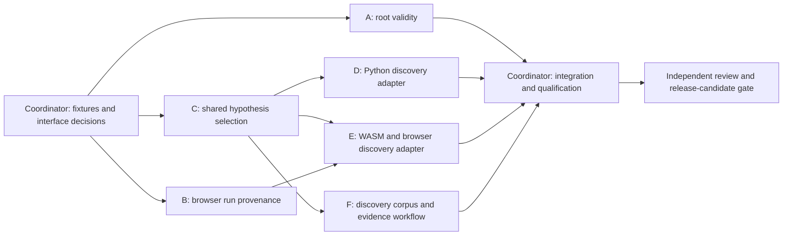

# Roadmap: from decimal to testable conjecture

Status: packets A–F implemented on November 15, 2026 for the local 3.0.0
development candidate, following the November 14 review. The earlier six fixes
are preserved. The three review findings are addressed by the range guard,
immutable browser runs, and shared discovery selection below. This is a delivery
record and acceptance specification, not a release or deployed-site claim.

| Packet | Delivered behavior | Regression/evidence surface |
| --- | --- | --- |
| A | Conservative squared-trig/domain range propagation | Numerical contract across matchers and Newton settings |
| B | Immutable completed-run state and exports | Worker-flight, edits, errors, empty results, copy/download |
| C | Additive shared discovery with precision-resolving cost tiers | Rust discovery, branch/cost/boundary tests, existing report regressions |
| D | Python literal-aware discovery returning a plain run dictionary | Fresh installed wheel, raw compatibility, serialization, GIL release |
| E | WASM discovery and browser default, full-run/selected JSON | Actual wasm32, package entries, source/built browser flows |
| F | Independent discovery corpus and selected-equation certificate workflow | Tool counterexamples, fixed corpus, explicit unsupported cases |

The current contracts are in [SEARCH_MODEL.md](SEARCH_MODEL.md), the binding
guides, and [DISCOVERY_WORKFLOW.md](DISCOVERY_WORKFLOW.md). Local receipts are
kept with the execution evidence; reproduce qualification with
[QUALIFICATION.md](QUALIFICATION.md). Full release-candidate acceptance still
requires the separate clean exact-commit gate in [RELEASING.md](../RELEASING.md).

## Outcome and scope

A user supplies a decimal and receives a small set of distinct, concise
hypotheses that respect the supplied precision, preserve their search provenance,
and offer an explicit next validation step. Deliver that workflow through the
CLI/Rust library, Python, and browser using the shared engine.

Optimize elapsed time by running independent packets concurrently, agreeing on
interfaces before adapter work, and running each expensive integration check once
per relevant source state. Preserve numerical contracts, historical/raw ranking
options, and existing public entry points. See [VALIDATION.md](VALIDATION.md) for
check selection and evidence reuse; [SEARCH_MODEL.md](SEARCH_MODEL.md) remains
the current behavior contract.

Defer new operator families, general symbolic proof, arbitrary-precision target
search, PSLQ expansion, broad UI redesign, and speculative performance tuning.
They are not prerequisites for this outcome.

## Completion criteria

- The squared-trig and squared-reciprocal impossible-root regressions are rejected
  across applicable matchers; nearby real roots remain discoverable.
- Browser cards, text, copy, and download describe the completed run even after
  fields change, while searching, or after a later search fails.
- The discovery workflow leads with `x = pi`, `x = sqrt(2)` / `x^2 = 2`, and
  `x = sqrt(e)` / `x^2 = e` for representative rounded targets. They appear in the
  first three distinct hypotheses under a declared grammar/budget that admits
  them. Smaller residuals inside the input uncertainty do not displace them.
- A selected hypothesis carries the original target literal, resolved search
  settings, and explicit validation availability. Existing raw search consumers
  retain a documented compatibility path.
- Regression, qualification, and installed-consumer evidence cover the integrated
  implementation. A separate fixed discovery corpus measures top-k recovery and
  redundant results; it makes no universal completeness or confidence claim.

## Coordinator contract

Use one coordinator and up to three implementation agents by default. Each agent
has exclusive file ownership for its packet. More agents help only when there
are more independent file sets; overlapping edits and concurrent heavyweight
builds usually lengthen the critical path.

Before dispatch, the coordinator records the initial dirty tree, packet owners,
shared interfaces, acceptance fixtures, and which checks can reuse existing
evidence. Preserve prior user work. A worktree is useful for independent commits;
a shared checkout is acceptable with exclusive ownership. Do not run parallel
Cargo builds against the same target directory. Limit concurrent heavy builds
according to available memory; keep normal incremental caches within one owner.

Workers deliver a bounded patch, focused regression evidence, changed paths,
contract/doc impact, and any unresolved limitation. They do not each run the full
matrix. The coordinator integrates completed packets as they arrive, reviews
cross-packet behavior, and owns one affected-surface integration pass. An
independent reviewer checks the final integration and counterexamples without
repeating already valid expensive checks. Source changes invalidate the affected
evidence as specified in [VALIDATION.md](VALIDATION.md).

## Dependency graph and launch order

Launch A, B, and C together. As a slot becomes free, prepare F's independent
fixtures and expected answers without changing C's files. Freeze C's interface
before D/E implementation; adapter fixtures and documentation can be prepared
earlier. Then run D, E, and F concurrently. The critical path is C → D/E →
integration, so the coordinator resolves shared-selection API decisions first.
Do not wait for every packet to finish before reviewing a completed one.

## Packets and exclusive ownership

### A — Close proven impossible-root gaps

**Start:** immediately. **Depends on:** acceptance fixtures only.

**Own:** `src/eval.rs`, `src/search/newton.rs`, and
`tests/numeric_contract.rs`. Coordinate any other matcher call-site change before
editing it; leave selection/reporting and bindings to their owners.

Propagate conservative ranges through square and supported unary compositions.
Reject `cospi(x)^2 = 1.0000000000000002` and
`(1/cospi(x))^2 = 0.9999999999999999`, including their relevant sign/reciprocal
variants, without treating small residuals as proof of root existence. Unknown
ranges remain unknown; do not invent a general interval solver in this packet.
Test interior values, endpoints, domain gaps, and nearby legitimate roots across
serial/streaming/parallel/turbo where supported. Run focused numerical contract
checks first; leave the full engine matrix to integration.

**Done:** the reported counterexamples fail discovery and positive controls pass.

### B — Bind browser results to an immutable run

**Start:** immediately. **Depends on:** no engine change.

**Own:** `web/index.html`, `web/search-worker.js`, and browser regression tests
for this packet. E takes those files only after B hands them over. Use a separate
spec file if that simplifies the later handoff; keep the smoke command discovering
any new spec.

Store a completed run with its original target text, resolved options, and
matches. Render/export from that snapshot; identify edited controls as pending
settings. Capture options before dispatch so edits during a worker search cannot
relabel its result. Define consistent behavior after empty results, failure, and
view changes. Keep the UI changes focused on accurate state and provenance.

**Done:** regressions cover edit-without-search, edit-during-search, text/cards,
copy/download, and a failed subsequent search. JSON/run-envelope additions can
follow E; this fix must not wait for the new shared selection API.

### C — Share precision-aware hypothesis selection

**Start:** immediately; prioritize the interface decision.

**Own:** a new core selection module, `src/report.rs`, `src/match_summary.rs`,
`src/lib.rs`, and dedicated selection tests. Coordinate `src/pool.rs` changes;
keep the documented raw comparator intact unless a separately reviewed contract
change is necessary. Own the corresponding selection-contract documentation.

Extract a policy usable before the final result limit: resolve input precision,
prefer lower complexity among hypotheses consistent with that precision, and
collapse safely recognizable duplicate displayed hypotheses. Preserve branch and
domain assumptions; numerical root proximity alone is not equivalence. Retain
original equation identities as supporting variants. Keep adequate candidates
before selection so raw top-k truncation cannot erase the simple hypothesis.

The coordinator and C owner freeze a small shared policy/result interface with:
original target literal; resolved precision tolerance and grammar/budgets;
selection mode; representative hypotheses plus supporting equation identities;
and explicit numerical/validation status. Decide how callers without a literal
behave and how discovery mode differs from the compatibility/raw mode. Introduce
additive APIs or a versioned result envelope rather than silently breaking the
existing `search()` return type or manifest schema.

**Done:** rounded pi, sqrt(2), and sqrt(e) lead the selection fixtures; artificial
sub-precision correction terms and repeated presentations cannot crowd them out.
Raw-order, custom-weight, branch, exactness, and determinism regressions pass.

### D — Expose the discovery contract in Python

**Start:** after C's interface freezes. **Depends on:** C.

**Own:** `ries-py/`, Python API docs, and Python-specific fixtures. Preserve the
existing float-based `search()` API and its documented behavior; add a discovery
entry point/options path using the shared policy. Accept a decimal literal for
precision-aware discovery and expose resolved configuration and result evidence.
Implement only the options needed by this milestone; route advanced CLI-only
workflows explicitly rather than copying the entire CLI parser.

**Done:** installed-wheel tests exercise literal precision, simple-hypothesis
selection, serialization, invalid input, and compatibility of existing calls.
Reuse the coordinator's wheel build for further unchanged Python-only tests.

### E — Connect WASM/browser to shared selection and evidence

**Start:** after C freezes its interface and B releases its files.
**Depends on:** B + C.

**Own:** `src/wasm.rs`, `web/`, browser/WASM regression tests, and their API docs.
Use the shared discovery policy for the default discovery workflow, retaining an
explicit raw/parity option. Render a short distinct-hypothesis list with the
original precision and completed-run settings. Separate floating-point agreement,
optional high-precision corroboration, and an independently bounded polynomial
root; show unavailable checks with a reason. Give the selected hypothesis a
concrete export/verification step supported by existing tools. Do not imply a
probability of mathematical truth or a symbolic proof.

**Done:** real WASM browser tests recover the three rounded known answers, preserve
B's run-state guarantees, and verify exported settings and supported CAS semantics.
Build each required WASM target once; reuse it for unchanged browser iterations.

### F — Measure discovery quality and connect existing verification

**Start:** independent corpus design can start as soon as a slot is free.
**Depends on:** C's result contract for integration.

**Own:** a separate discovery corpus, discovery-quality runner/tests, narrowly
scoped verification/export tooling, and qualification/benchmark docs. Coordinate
any shared schema change; A/C/D/E retain their runtime files.

Include withheld known formulas under explicit allowed grammars, rounded and
truncated versions, near misses, seeded control decimals, and both general/domain
presets. Separate recognition of an injected named constant from recovery of a
formula. Measure top-1/top-3/top-k known-answer recovery, unique-hypothesis count,
redundancy, precision sensitivity, and runtime on a fixed environment. Control
results calibrate behavior; do not declare every formula for a control a false
positive or infer a statistical confidence score without a model.

Connect existing high-precision reevaluation and conservative polynomial
certificates through a reproducible selected-hypothesis export; report unsupported
cases explicitly. Keep a small deterministic regression corpus in ordinary CI;
run repeated timing studies on demand. Existing matcher qualification remains
independent and keeps its current finite scope.

**Done:** independent expected answers catch selection regressions, artifacts name
the exact source/configuration, and a documented end-to-end example goes from a
typed decimal to a hypothesis, reproducible export, and available validation.

## Integration and release exit

The coordinator owns CI changes, shared build/configuration files, active doc
navigation, and final contract reconciliation. Packet owners request edits to
these files instead of racing on them. Use the change matrix in
[VALIDATION.md](VALIDATION.md); overlapping packet evidence can be reused only
when its full relevant input set is unchanged.

Before marking the milestone complete, independently review A's domain/range
reasoning, B/E's run provenance, C's truncation and equivalence rules, and D/E's
compatibility path. Run affected feature/binding/browser/qualification checks
once on the integrated state. Final release-candidate validation uses a clean
immutable commit and fresh installed artifacts as required by
[RELEASING.md](../RELEASING.md). CI success or local testing does not establish
publication, deployed-site behavior, or universal mathematical correctness.

Track each packet with owner, status (`ready`, `active`, `review`, `done`, or
`blocked` with a reason), dependencies, changed paths, and evidence location in
the coordinator's task record. Update this roadmap only for scope, dependency,
acceptance, or milestone-status changes; do not turn it into a transcript.
